# Отчёт ДЗ №1
#### Дима Милана, 408541

# Матрица проверок

| Правило               | Класс или граница                                  | Пример входных данных                                          | Ожидаемый результат                                                                                                   |
|-----------------------|----------------------------------------------------|----------------------------------------------------------------|-----------------------------------------------------------------------------------------------------------------------|
| валидность результата | нарушений нет                                      | `Aa1!bcde`                                                     | `isValid() == true`, список нарушений пуст                                                                            |
| валидность результата | есть нарушение                                     | `Aa1!bcd`                                                      | `isValid() == false`, присутствует `TOO_SHORT`                                                                        |
| `null`                | пароль отсутствует                                 | `check(null)`                                                  | выброшено `IllegalArgumentException`, объект результата не создаётся                                                  |
| `TOO_SHORT`           | граница 7                                          | `Aa1!bcd`                                                      | присутствует `TOO_SHORT`                                                                                              |
| `TOO_SHORT`           | граница 8                                          | `Aa1!bcde`                                                     | `TOO_SHORT` отсутствует                                                                                               |
| `TOO_LONG`            | граница 64                                         | валидная строка длины 64 без серий из трёх одинаковых символов | `TOO_LONG` отсутствует                                                                                                |
| `TOO_LONG`            | граница 65                                         | валидная строка длины 65 без серий из трёх одинаковых символов | присутствует `TOO_LONG`                                                                                               |
| `NO_DIGIT`            | цифр нет                                           | `Aa!bcdef`                                                     | присутствует `NO_DIGIT`                                                                                               |
| `NO_DIGIT`            | цифра есть                                         | `Aa1!bcde`                                                     | `NO_DIGIT` отсутствует                                                                                                |
| `NO_UPPER`            | заглавной латинской буквы нет                      | `aa1!bcde`                                                     | присутствует `NO_UPPER`                                                                                               |
| `NO_UPPER`            | заглавная латинская буква есть                     | `Aa1!bcde`                                                     | `NO_UPPER` отсутствует                                                                                                |
| `NO_UPPER`            | есть только заглавная нелатинская буква            | `Яa1!bcde`                                                     | присутствует `NO_UPPER`                                                                                               |
| `NO_LOWER`            | строчной латинской буквы нет                       | `AA1!BCDE`                                                     | присутствует `NO_LOWER`                                                                                               |
| `NO_LOWER`            | строчная латинская буква есть                      | `Aa1!bcde`                                                     | `NO_LOWER` отсутствует                                                                                                |
| `NO_LOWER`            | есть только строчная нелатинская буква             | `Aя1!БВГД`                                                     | присутствует `NO_LOWER`                                                                                               |
| `NO_SPECIAL`          | разрешённого специального символа нет              | `Aa1bcdef`                                                     | присутствует `NO_SPECIAL`                                                                                             |
| `NO_SPECIAL`          | разрешённый специальный символ есть                | `Aa1!bcde`                                                     | `NO_SPECIAL` отсутствует                                                                                              |
| `NO_SPECIAL`          | есть символ вне разрешённого набора                | `Aa1.bcde`                                                     | присутствует `NO_SPECIAL`                                                                                             |
| `NO_SPECIAL`          | каждый символ из `!@#$%^&*()-_=+`                  | параметризованный набор `Aa1<символ>bcde`                      | `NO_SPECIAL` отсутствует для каждого символа                                                                          |
| `HAS_WHITESPACE`      | пробельных символов нет                            | `Aa1!bcde`                                                     | `HAS_WHITESPACE` отсутствует                                                                                          |
| `HAS_WHITESPACE`      | есть обычный пробел                                | `Aa1! bcd`                                                     | присутствует `HAS_WHITESPACE`                                                                                         |
| `HAS_WHITESPACE`      | есть табуляция или перевод строки                  | параметризованные `Aa1!\tbcd`, `Aa1!\nbcd`                     | присутствует `HAS_WHITESPACE`                                                                                         |
| `REPEATED_RUN`        | граница 2                                          | `Aa1!bbcd`                                                     | `REPEATED_RUN` отсутствует                                                                                            |
| `REPEATED_RUN`        | граница 3                                          | `Aa1!bbbc`                                                     | присутствует `REPEATED_RUN`                                                                                           |
| `REPEATED_RUN`        | более трёх символов                                | `Aa1!bbbb`                                                     | присутствует `REPEATED_RUN`                                                                                           |
| `REPEATED_RUN`        | повторы расположены не подряд                      | `Aa1!bcbc`                                                     | `REPEATED_RUN` отсутствует                                                                                            |
| `CONTAINS_LOGIN`      | непустой логин входит в пароль                     | `check("Aa1!ivan", "ivan")`                                    | присутствует `CONTAINS_LOGIN`                                                                                         |
| `CONTAINS_LOGIN`      | вхождение без учёта регистра                       | `check("Aa1!IvAn", "iVaN")`                                    | присутствует `CONTAINS_LOGIN`                                                                                         |
| `CONTAINS_LOGIN`      | непустой логин не входит                           | `check("Aa1!bcde", "ivan")`                                    | `CONTAINS_LOGIN` отсутствует                                                                                          |
| `CONTAINS_LOGIN`      | пустой логин                                       | `check("Aa1!bcde", "")`                                        | правило не применяется, `CONTAINS_LOGIN` отсутствует                                                                  |
| `CONTAINS_LOGIN`      | логин равен `null`                                 | `check("Aa1!bcde", null)`                                      | правило не применяется, `CONTAINS_LOGIN` отсутствует                                                                  |
| `CONTAINS_LOGIN`      | перегрузка без логина                              | `check("Aa1!bcde")`                                            | правило не применяется, `CONTAINS_LOGIN` отсутствует                                                                  |
| `BLACKLISTED`         | полное совпадение                                  | `password`, `qwerty`, `123456`, `admin`, `welcome`             | для каждого значения присутствует `BLACKLISTED`                                                                       |
| `BLACKLISTED`         | совпадение без учёта регистра                      | `PaSsWoRd`                                                     | присутствует `BLACKLISTED`                                                                                            |
| `BLACKLISTED`         | значение не входит в список                        | `Aa1!bcde`                                                     | `BLACKLISTED` отсутствует                                                                                             |
| `BLACKLISTED`         | запрещённое слово является только частью пароля    | `Aa1!passwordX`                                                | `BLACKLISTED` отсутствует, поскольку требуется совпадение                                                             |
| накопление нарушений  | несколько независимых правил нарушены одновременно | `aaa`                                                          | одновременно присутствуют все применимые нарушения: `TOO_SHORT`, `NO_DIGIT`, `NO_UPPER`, `NO_SPECIAL`, `REPEATED_RUN` |

# Запуск тестов до исправления реализации:
| 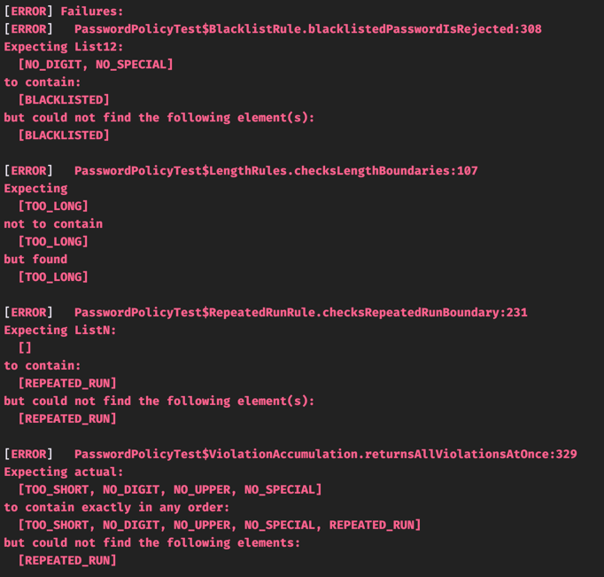  | 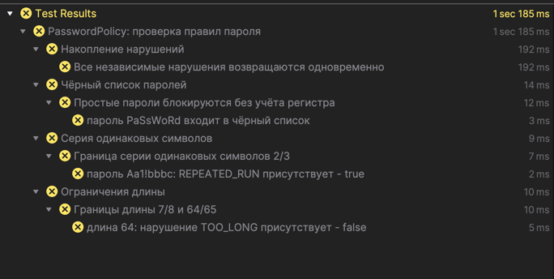 |
|---------------------------------------|------------------------------------------|

# Баг-репорты PasswordPolicy

## BUG-01. Пароль длиной 64 символа ошибочно получает TOO_LONG

Тест: `PasswordPolicyTest.LengthRules#checksLengthBoundaries`

Создан валидный по остальным правилам пароль длиной ровно 64 
символа: он содержит цифру, заглавную и строчную латинские 
буквы, разрешённый специальный символ, не содержит пробелов 
и серий из трёх одинаковых символов

**Окружение**

- Проект: `code/demo-junit`, ветка `lab-1`
- Класс: `ru.mts.itmo.aqa.junit5.PasswordPolicy`
- JDK: Amazon Corretto 21.0.6
- Maven: 3.9.9

**Шаги воспроизведения**

1. создать экземпляр `PasswordPolicy`
2. вызвать `check(password)` с описанным паролем длиной 64 символа
3. проверить список `result.violations()`

**Фактический результат**

`TOO_LONG` присутствует в списке нарушений

**Ожидаемый результат**

`TOO_LONG` отсутствует в списке нарушений

**Цитата из спецификации**
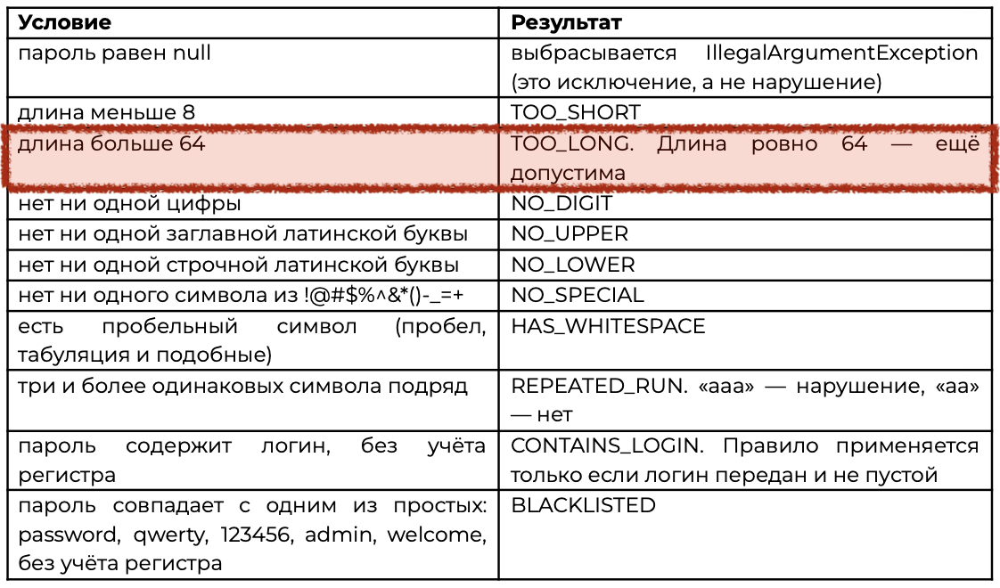

**Severity**  
Major  
валидный граничный пароль отклоняется, пользователь 
не может использовать разрешённое значение

**Priority**  
High  
ошибка находится на явно заданной границе 64 и 65 символов

## BUG-02. Серия ровно из трёх одинаковых символов не получает REPEATED_RUN

Тест: `PasswordPolicyTest.RepeatedRunRule#checksRepeatedRunBoundary`

Подготовлен пароль `Aa1!bbbc`, который содержит серию ровно
из трёх символов `b` подряд и удовлетворяет всем остальным правилам

Эта же проблема воспроизводится в тесте с проверкой накопления 
нарушений, но так как причина та же, в отдельный репорт не выношу

**Окружение**

- Проект: `code/demo-junit`, ветка `lab-1`
- Класс: `ru.mts.itmo.aqa.junit5.PasswordPolicy`
- JDK: Amazon Corretto 21.0.6
- Maven: 3.9.9

**Шаги воспроизведения**

1. создать экземпляр `PasswordPolicy`
2. вызвать `check("Aa1!bbbc")`
3. проверить список `result.violations()`

**Фактический результат**

`REPEATED_RUN` отсутствует в списке нарушений

**Ожидаемый результат**

`REPEATED_RUN` присутствует в списке нарушений

**Цитата из спецификации**
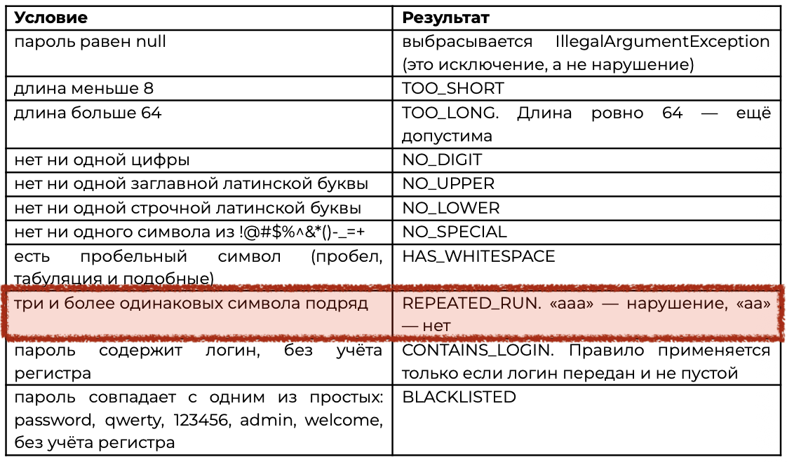

**Severity**  
Major  
реализация пропускает пароль, нарушающий правило

**Priority**  
High  
дефект влияет на надежность проверки пароля, ошибка
возникает на явно заданной границе 2 и 3

## BUG-03. Чёрный список учитывает регистр пароля

Тест: `PasswordPolicyTest.BlacklistRule#blacklistedPasswordIsRejected`

Используется пароль `PaSsWoRd`, который отличается от имеющегося
в чёрном списке `password` только регистром

**Окружение**

- Проект: `code/demo-junit`, ветка `lab-1`
- Класс: `ru.mts.itmo.aqa.junit5.PasswordPolicy`
- JDK: Amazon Corretto 21.0.6
- Maven: 3.9.9

**Шаги воспроизведения**

1. создать экземпляр `PasswordPolicy`
2. вызвать `check("PaSsWoRd")`
3. проверить список `result.violations()`

**Фактический результат**

`BLACKLISTED` отсутствует в списке нарушений (возвращаются 
только другие релевантные нарушения: `NO_DIGIT` и `NO_SPECIAL`)

**Ожидаемый результат**

`BLACKLISTED` присутствует в списке нарушений

**Цитата из спецификации**
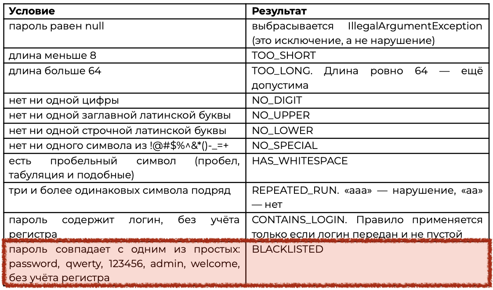

**Severity**  
Major  
запрещённый простой пароль проходит правило чёрного списка при
изменении регистра

**Priority**  
Low  
дефект позволяет обойти правила, но все пароли из черного списка
и так не пройдут по другим нарушениям, вне зависимости от регистра  
пока не планируется изменение правил или расширение черного списка, 
пользователя не затронет эта проблема

# Запуск тестов после исправления реализации:
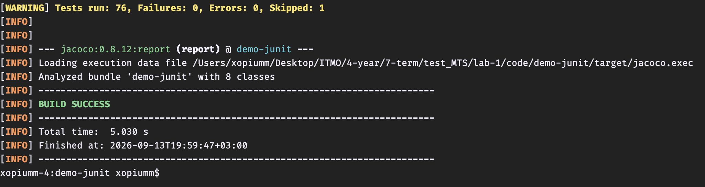

# Отчёт Jacoco
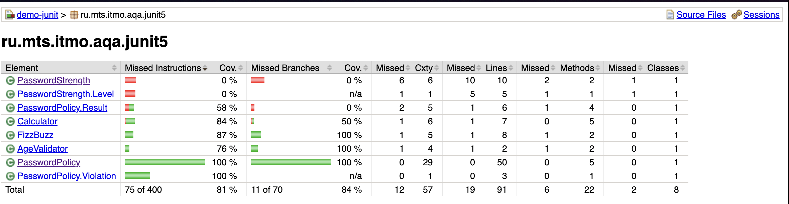
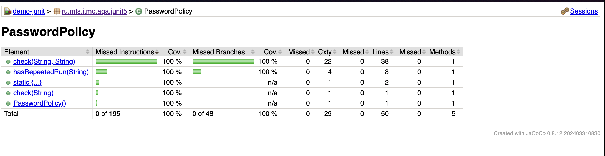

# Отчёт Allure

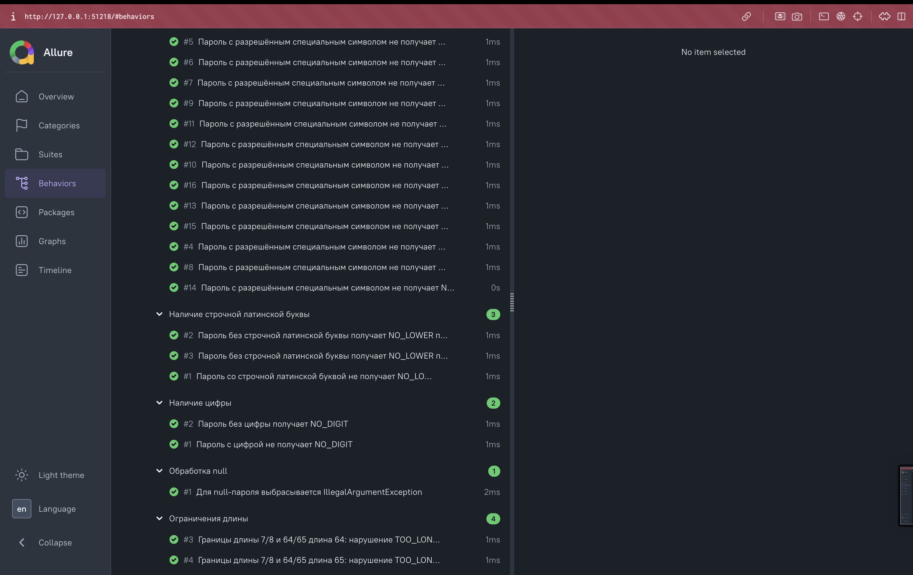
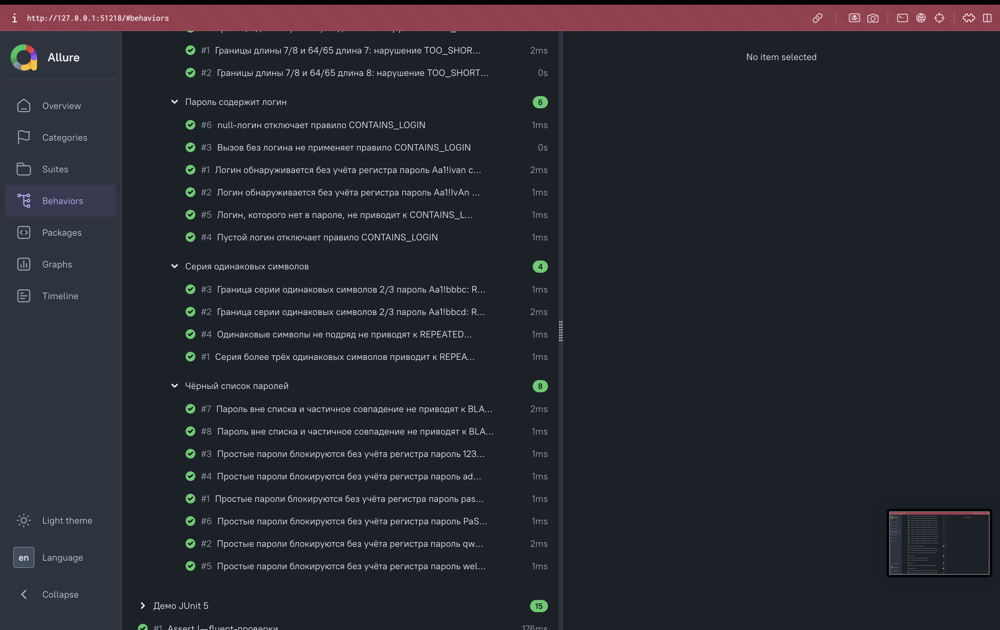

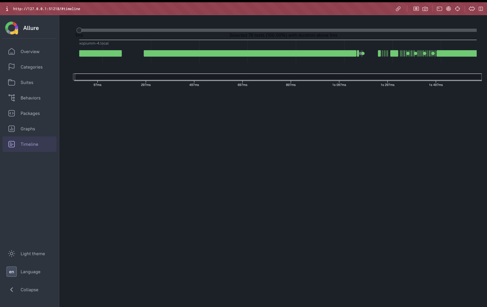
