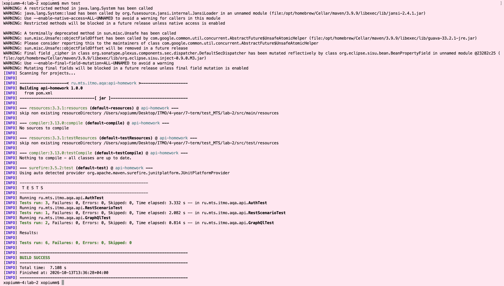

# Домашнее задание №2 — API-автотесты

Maven-проект на Java 17, JUnit 5 и RestAssured. 
Тестируются [Playground REST API](https://playground.nileslabs.com/api/v1) и [Postman Echo GraphQL](https://graphql.postman-echo.com/graphql).

## Запуск

из test_MTS/lab-2:
```bash
mvn test
```

## Сценарии

- `RestScenarioTest`: POST `/posts` - извлечение `id` - PATCH `/posts/{id}` - GET `/posts/{id}`. Проверяются статус, `id`, изменённый `title` и сохранённый `body`. Для сохранения состояния между запросами используется `X-Playground-Identity`, полученный в начале сценария.
- `AuthTest`: POST `/auth/login` - получение `access_token` - GET `/auth/me` с Bearer-токеном. Проверяются идентифицирующие поля пользователя. Отдельные тесты проверяют отказ без токена и с неверным токеном, второй служит дополнительным негативным сценарием.
- `GraphQlTest`: query `Hello` и mutation `CreatePerson`, проверяются HTTP 200, `data`, значения полей и отсутствие `errors`.
- `api_testing_homework.postman_collection.json`: коллекция с REST и GraphQL запросами, включая `subscription Greetings { greetings }` с `Accept: text/event-stream`.


