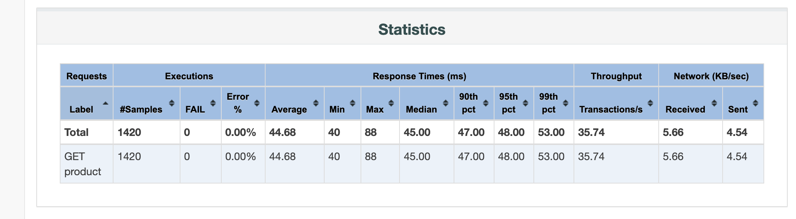
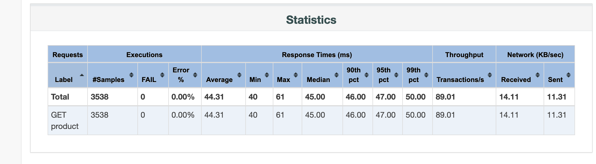
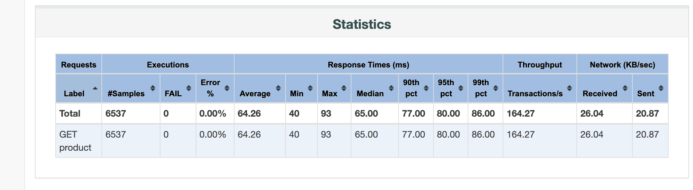
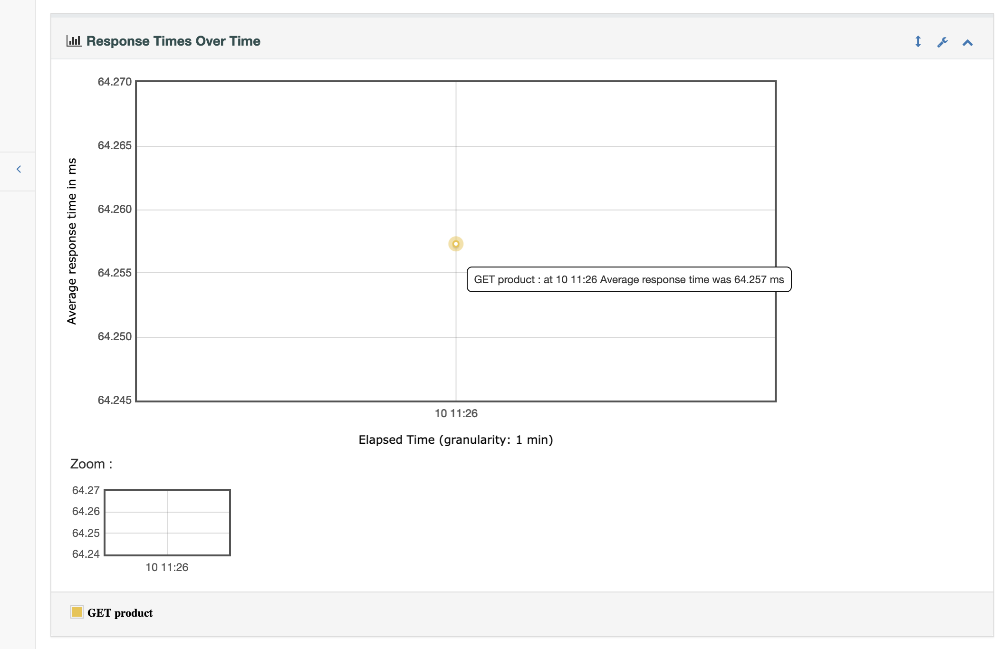
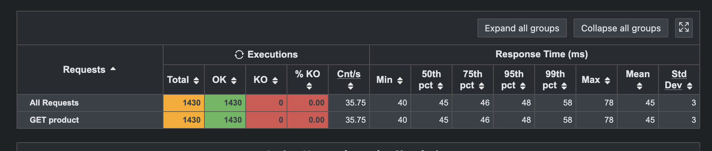
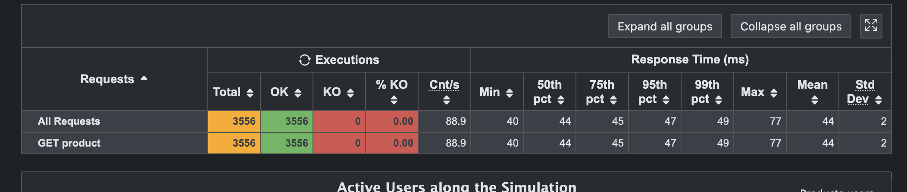
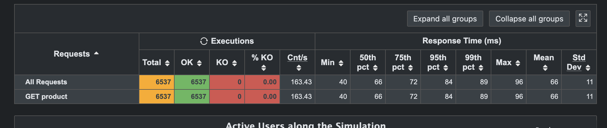

# Д/з №4: Нагрузочное тестирование API
#### Дима Милана, 408541

## Сценарий

`GET /api/products/{id}` возвращает JSON с полями `id`, `name`, `price`.
Идентификаторы от 1 до 10 читаются по кругу из CSV. В обоих инструментах
проверяются HTTP 200 и соответствие `id` значению из CSV. Перед каждым
запросом установлена пауза 200 мс, в том числе перед первым запросом.

Сервис написан на Java без внешних зависимостей. Он слушает только
`127.0.0.1:8087`, использует восемь обработчиков и задержку 40 мс на запрос. 
Базы данных нет.

## Запуск

В первом терминале запускается сам сервис:

```bash
bash scripts/start-service.sh
```

Во втором терминале проверяется одиночный запрос:

```bash
curl --fail http://127.0.0.1:8087/api/products/1
```

Ожидаемый ответ:

```json
{"id":1,"name":"Product 1","price":100}
```

После проверки выполняем три запуска JMeter последовательно:

```bash
bash scripts/run-jmeter.sh 10 10 40
bash scripts/run-jmeter.sh 25 10 40
bash scripts/run-jmeter.sh 50 10 40
```

Аргументы: число пользователей, ramp-up в секундах, полная длительность
в секундах. Ramp-up входит в длительность. После ramp-up остаётся 30 секунд
при заданном количестве пользователей. Итерации повторяются до конца запуска.
Тайм-аут подключения 3 секунды, для ответа 5 секунд.

Скрипт запускает JMeter и сохраняет JTL и HTML Report.

## Профиль нагрузки

| Запуск | Пользователи | Ramp-up, с | Длительность, с | Пауза, мс |
|--------|-------------:|-----------:|----------------:|----------:|
| 1      |           10 |         10 |              40 |       200 |
| 2      |           25 |         10 |              40 |       200 |
| 3      |           50 |         10 |              40 |       200 |

Пользователь ждёт ответа и паузы перед следующим
запросом. Число пользователей задано, RPS измеряется по результатам.
Все основные запуски выполняются последовательно на одном сервисе.

## Результаты JMeter

| Инструмент / пользователи | Запросы |    RPS | Average, мс | p95, мс | Ошибки, % |
|---------------------------|--------:|-------:|------------:|--------:|----------:|
| JMeter / 10               |    1420 |  35.74 |       44.68 |      48 |      0.00 |
| JMeter / 25               |    3538 |  89.01 |       44.31 |      47 |      0.00 |
| JMeter / 50               |    6537 | 164.27 |       64.26 |      80 |      0.00 |

Показатели рассчитаны для полного запуска, включая ramp-up.

Исходные результаты и отчёты:

- [10 пользователей](results/jmeter-10/results.jtl) [HTML Report](results/jmeter-10/report/index.html)
- [25 пользователей](results/jmeter-25/results.jtl) [HTML Report](results/jmeter-25/report/index.html)
- [50 пользователей](results/jmeter-50/results.jtl) [HTML Report](results/jmeter-50/report/index.html)









## Gatling

Аналогичный сценарий описан на Java в
[ProductsSimulation.java](gatling/src/test/java/ru/mts/itmo/aqa/ProductsSimulation.java).
Используются тот же endpoint, набор ID, пауза, проверки и уровни нагрузки.
Копия CSV лежит в ресурсах Maven, скрипт проверяет её совпадение с исходным файлом.
Gatling плавно увеличивает число одновременных пользователей от 0 до заданного
за 10 секунд, затем поддерживает его 30 секунд. В отличие от JMeter, завершившихся
пользователей закрытой модели Gatling может заменять, здесь сценарий каждого
пользователя зациклен и ограничен общей длительностью.

```bash
bash scripts/run-gatling.sh 10 10 40
bash scripts/run-gatling.sh 25 10 40
bash scripts/run-gatling.sh 50 10 40
```

Maven автоматически формирует HTML-отчёт и `simulation.log` в `results/gatling`.
Каждый запуск получает отдельную папку. Путь к `index.html` выводится в терминале.

| Инструмент / пользователи | Запросы |    RPS | Average, мс | p95, мс | Ошибки, % |
|---------------------------|--------:|-------:|------------:|--------:|----------:|
| Gatling / 10              |    1430 |  35.75 |          45 |      48 |      0.00 |
| Gatling / 25              |    3556 |   88.9 |          44 |      47 |      0.00 |
| Gatling / 50              |    6537 | 163.43 |          66 |      84 |      0.00 |

Сохранённые HTML-отчёты и исходные `simulation.log`:

- [10 пользователей](results/gatling-10/index.html) [simulation.log](results/gatling-10/simulation.log)
- [25 пользователей](results/gatling-25/index.html) [simulation.log](results/gatling-25/simulation.log)
- [50 пользователей](results/gatling-50/index.html) [simulation.log](results/gatling-50/simulation.log)







## Вывод

При увеличении нагрузки с 10 до 25 пользователей RPS вырос с 35.74 до 89.01,
а среднее время ответа осталось около 44-45 мс. В этом диапазоне сервис
показал стабильное время ответа, ошибок и выраженного роста p95 не было.

На 50 пользователях RPS вырос до 164.27, среднее время ответа до 64.26 мс,
p95 до 80 мс. Рост пропускной способности стал меньше пропорционального:
число пользователей удвоилось, RPS вырос примерно в 1.85 раза. Это согласуется
с появлением ожидания свободного обработчика: у сервиса восемь обработчиков
и задержка 40 мс.

Ошибок не было на всех трёх уровнях. Явного плато RPS или отказа сервиса
не обнаружено. Диапазон 10–25 пользователей можно считать стабильным по времени
ответа в рамках этого эксперимента, и на 50 пользователях сервис продолжает
работать без ошибок, но задержки уже растут. Gatling подтвердил ту же тенденцию.
